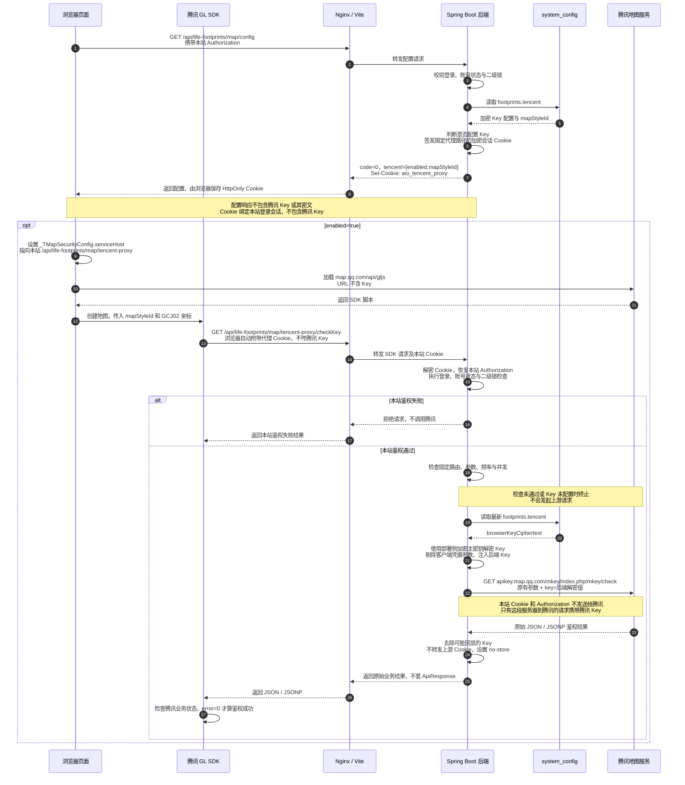
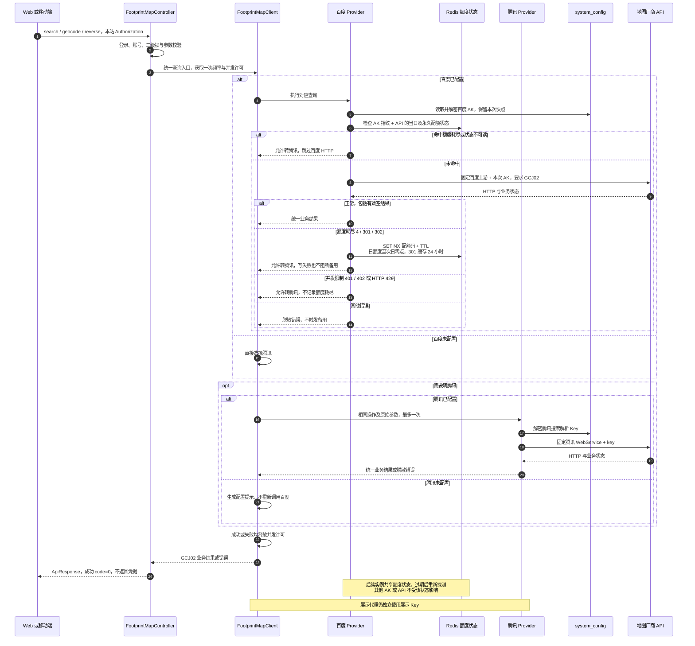

# 腾讯地图代理接入

Web 足迹主地图及新增、编辑弹窗统一采用腾讯 GL 的[官方代理方案](https://lbs.qq.com/webApi/javascriptGL/glGuide/glKeyDelegate)。腾讯 Key 只在后端转发请求时解密并注入，浏览器仅取得地图可用状态、样式和本站代理地址。

## 请求时序

以下以首次打开足迹页面、SDK 校验 Key 为例。Nginx 代表本站已有的 `/api` 反向代理；本地开发由 Vite 承担这一层。

SDK 的无 Key 脚本加载请求直接访问腾讯；需要 Key 的校验、统计及海外控制请求通过本站代理。普通底图资源仍由 SDK 按需加载，Nginx 不保存或注入腾讯 Key。

## 后端注入规则

代理前缀为 `/api/life-footprints/map/tencent-proxy`，只开放以下 GET 路由：

| 代理后缀 | 固定腾讯上游 | 后端注入参数 |
| --- | --- | --- |
| 空后缀 | `https://pr.map.qq.com/pingd` | `appid=jsapi_v3`、`key` |
| `/checkKey` | `https://apikey.map.qq.com/mkey/index.php/mkey/check` | `key` |
| `/oversea` | `https://overseactrl.map.qq.com/` | `apikey` |

Key 保存在 `system_config.config_key=footprints.tencent` 的 JSON 配置中。历史管理字段 `browserKey` 仅用于管理员提交新值，后端加密存为 `browserKeyCiphertext`；展示代理通过 `displayKey()` 解密取得。加密主密钥由部署侧的 `AIO_LIFE_NOTIFICATION_ENCRYPTION_KEY` 提供，前端和 Nginx 均不配置腾讯 Key。

转发前剔除客户端的 `key`、`key1`、`key2`、`apikey`、`subkey`、`servicesk`、`sig` 参数，再由后端补入当前 Key。上游固定，不接受用户指定 URL，不开放 `/service` WebService 转发；地点搜索、正向及逆向地址解析通过本站业务接口统一编排：优先百度，百度额度耗尽时调用腾讯 WebService 的搜索解析 Key。

## 双 Key 分工

两把 Key 都保存在 `footprints.tencent`，都只在后端解密使用；不会下发给 SDK 或页面。两把 Key 必须不同，服务端校验同值并拒绝保存。

| 用途 | 管理写入字段 | 加密存储字段 | 可用状态 | 清除字段 | 应用实际调用 |
| --- | --- | --- | --- | --- | --- |
| 地图展示 | `browserKey`（兼容历史字段名） | `browserKeyCiphertext` | `browserKeyConfigured` | `clearBrowserKey` | GL 校验、统计与海外控制固定代理 |
| 搜索解析 | `serviceKey` | `serviceKeyCiphertext` | `serviceKeyConfigured` | `clearServiceKey` | 关键词提示、地址转坐标、坐标转地址 |

两个输入框留空分别保留旧值，勾选对应清除项才移除；一项更新不会覆盖另一项。`timeoutMs` 控制搜索解析超时，范围 1000–15000ms，缺省 5000ms；GL 代理仍为 8 秒。管理接口只返回可用状态、样式与超时，不返回明文或密文。

- 展示 Key 在腾讯控制台仅用于 JavaScript API GL，不启用 WebService；`style1` 须绑定所需白浅样式。
- 搜索解析 Key 单独启用 WebService，并配置后端公网出口 IP 白名单。所需接口为「关键词输入提示」「地址解析」「逆地址解析」；当前实现采用 IP 校验，不计算 SN 签名。若控制台支持逐项授权，仅开放这些接口。
- **应用调用隔离不等于厂商权限自动配置**：系统不会替用户修改腾讯控制台权限。腾讯 JavaScript API GL 的可用性及 WebService 授权粒度以控制台为准，不能声称应用配置本身能让服务端 Key 在厂商侧彻底禁用 JS API。
- 历史展示 Key 自动保留，腾讯搜索解析 Key 不借用展示 Key。百度 AK 与腾讯搜索解析 Key 独立配置；任一查询凭据已配置即开放搜索。两家查询均未配置时地图显示与手工选点仍可用。
- `footprints.baidu` 保存百度查询 AK、超时和移动端 H5 的 XYZ 瓦片配置；恢复使用历史加密 AK，无需重新迁移。Web 不读取这些瓦片；Web 与移动端共用查询编排。

## 查询接口与供应商切换

`FootprintMapProvider` 定义 `available / search / geocode / reverse`。`BaiduFootprintMapProvider` 与 `TencentFootprintMapProvider` 分别实现请求参数、配额错误识别与结果转换；公共抽象类 `AbstractFootprintMapProvider` 负责固定上游 HTTP 请求、超时、业务状态校验、脱敏和 GCJ02 结果映射。`FootprintMapClient` 只负责选择供应商及统一限流，Controller 无需知道具体厂商。

| 情况 | 行为 |
| --- | --- |
| 百度已配置且成功，包括有效空列表 | 直接返回百度结果，不调用腾讯 |
| Redis 已记录当前 AK、当前 API 的额度耗尽 | 跳过百度，直接执行腾讯查询 |
| 百度 JSON `status=4 / 302` | 写入当日额度状态至北京时间次日零点，本次转腾讯 |
| 百度 JSON `status=301` | 写入永久配额超限状态，缓存 24 小时后允许重新探测；本次转腾讯 |
| 百度 JSON `status=401 / 402` 或 HTTP `429` | 本次转腾讯，不写入额度耗尽状态，后续请求仍可尝试百度 |
| Redis 读写失败 | 返回受控备用信号，本次转腾讯；不泄露 Redis 连接信息 |
| 百度未配置，腾讯已配置 | 直接使用腾讯 |
| 百度超时、其他 HTTP 错误、鉴权/参数错误或非法响应 | 返回脱敏错误，不切换，不掩盖配置问题 |
| 需要备用但腾讯未配置 | 提示补充腾讯搜索解析 Key，允许手工选点；已发现的百度额度耗尽仍会保存 |
| 腾讯也失败或耗尽 | 返回错误，不循环重试百度；不清除百度额度状态 |

配额码按供应商独立解释：百度 `4` 表示当日配额校验失败，`301` 为永久配额超限，`302` 为天配额超限；`401/402` 属于并发限制，只触发当次备用。腾讯 `121` 为每日配额上限，`120` 为每秒请求量上限，不能把两家的同数字状态码混用。本站自身的用户限流仍直接返回 429，不能通过切换供应商绕过。

### Redis 额度状态

- `BaiduMapQuotaStore` 使用现有 `StringRedisTemplate`，状态跨实例共享。键格式为 `footprints:baidu:quota:v1:<AK SHA-256>:<固定 API 路径>:day:<北京时间日期>` 或 `:permanent`；值仅为配额码，不保存明文 AK、用户、地址或搜索词。
- 按 AK 和实际 API 路径隔离，不因搜索耗尽而停用尚可用的正/逆地理编码；全国搜索 v2 与城市检索 v3 分别记录。切换到另一个 AK 后立即使用其独立状态；恢复原 AK 仍遵守其尚未过期的状态。
- 请求前检查 Redis；发现耗尽后用带 TTL 的 `SET NX` 原子记录，不由重复或迟到错误延长过期时间。成功响应不删除状态，避免并发中的旧成功覆盖已确认的耗尽。
- 状态检查、HTTP 请求及错误写入共用同一 AK 快照，旧 AK 在途响应不会污染新 AK。日状态按请求开始时的北京时间日期归属；跨日迟到的错误不写入次日状态。
- 次日零点及 24 小时是**本系统的重新探测策略**，不是厂商保证届时恢复；再次确认耗尽会重新记录。永久配额不会每天零点自动恢复。补充额度后如需提前恢复，可由运维只删除该 AK 指纹、该 API 的额度键，或更换 AK；无需清空整个 Redis。
- Redis 不可读时保守地跳过百度；写失败也不阻断本次腾讯备用。若写入失败但随后 Redis 恢复，缺失的状态需下一次百度配额响应重新建立；不宣称故障期间状态已持久化。
- 第一次错误返回前已经发出的并发请求可能仍到达百度；本方案避免的是状态建立后的重复探测，不为所有查询增加分布式串行锁。

**免费额度边界**：根据厂商返回的配额耗尽状态切换，不读取余额、不计费，也无法从成功响应判断是否已消耗付费流量包。若账号启用了付费额度且上游继续成功，不会触发切换；不能据此承诺绝不产生费用。

## 搜索、名称与地址解析时序

地点名称搜索得到名称、地址与坐标候选；完整地址通过地理编码定位；选点后的逆解析只补充空的名称和地址，保持点击的 GCJ02 坐标不变。

百度全国搜索使用 `/place/v2/search`，指定城市使用 `/place/v3/region`；正向/逆向解析分别使用 `/geocoding/v3/`、`/reverse_geocoding/v3/`。均显式指定 GCJ02，地址长度保留百度原有 128 字节限制，过长直接提示精简，不截断用户地址。

腾讯搜索使用 `/ws/place/v1/suggestion`，全国不传 `region`，城市传 `region_fix=1`；正向与逆向都使用 `/ws/geocoder/v1/`，分别传 `address` 或 `location`。腾讯地址解析仅在 `reliability >= 7` 且 `level >= 9` 时标记较高精度，任何候选仍须用户确认。

查询按每实例每用户每分钟 60 次、并发 8 个限制；限流在编排层执行，百度到腾讯的切换只计一次业务请求，持有同一并发许可。两家分别读取各自 `timeoutMs`，一次备用查询的等待时间可能叠加两次上游耗时；底图 GL 代理沿用独立的限流和超时。

官方依据：[百度地理编码及状态码](https://lbsyun.baidu.com/docs/webapi?title=geocoding/guide/webservice-geocoding-base)、[百度配额与并发错误码](https://lbsyun.baidu.com/faq/api?title=lbscloud/api/appendix)、[腾讯状态码](https://lbs.qq.com/service/webService/webServiceGuide/status)、[腾讯关键词输入提示](https://lbs.qq.com/service/webService/webServiceGuide/webServiceSuggestion)、[腾讯地址解析](https://lbs.qq.com/service/webService/webServiceGuide/webServiceGeocoder)、[腾讯逆地址解析](https://lbs.qq.com/service/webService/webServiceGuide/webServiceGcoder)。

## 会话与失败处理

- 页面和 API 必须同源。代理 Cookie 为 HttpOnly、SameSite=Strict，HTTPS 下设置 Secure，路径只覆盖本站腾讯代理，最长有效一天；到期后重新加载页面取得新 Cookie。Cookie 使用 AES-GCM 加密原本站会话，撤销原登录后不能继续使用。
- SDK 的 JSONP / 统计请求不能自行附加项目的 Authorization 头，因此后端只在代理路径上从 Cookie 恢复凭据，随后仍执行现有认证链路。Cookie 不会替代或跳过登录、账号状态及二级锁检查。
- 每实例每用户每分钟最多 240 次、全局每分钟最多 2400 次、并发最多 16 个；连接超时 3 秒、总请求超时 8 秒，不跟随上游重定向。多实例部署需另行控制合计额度。
- 上游传输异常、非成功 HTTP 状态或不支持的响应类型返回脱敏错误；腾讯正常返回的 JSON / JSONP 保留原业务状态供 SDK 判断，不能仅凭 HTTP 200 判定成功。
- 既有 Key 无需重新保存，配置修改后后续代理请求读取新值。迁移代理不会撤销过去已在浏览器公开过的 Key；如需消除历史暴露风险，应在腾讯控制台轮换后重新保存。

## 实现入口

- 配置读取与 Cookie 签发：[FootprintMapController](../src/main/java/top/aiolife/record/api/FootprintMapController.java)、[TencentMapProxySessionFilter](../src/main/java/top/aiolife/record/filter/TencentMapProxySessionFilter.java)。
- 固定路由与 Key 注入：[TencentMapProxyController](../src/main/java/top/aiolife/record/api/TencentMapProxyController.java)、[TencentMapProxyClient](../src/main/java/top/aiolife/record/client/TencentMapProxyClient.java)。
- 配置加解密：[FootprintTencentConfigService](../src/main/java/top/aiolife/system/service/FootprintTencentConfigService.java)。

## 双 Key 阶段验证（2026-10-22，查询切换前）

后端 33 项专项测试通过，覆盖双 Key 加密、独立清除、拒绝同值、固定上游、业务状态、鉴权与退出失效；前端 8 项单元测试、类型与 ESLint 检查通过。模拟 API 与腾讯 SDK 的页面回归覆盖新增、编辑、搜索确认、选点、失败恢复及三种宽度的深浅主题。真实本地页面已验证新增与编辑使用腾讯底图、点击选点和代理 `error=0`，浏览器配置、SDK URL 与代理请求不含 Key。

搜索解析 Key 当前未配置，因此真实腾讯搜索、地址解析和权限限制尚未联调；测试夹具不代表该部分已可用。腾讯控制台权限未代改，移动端构建、真机与生产部署本次未执行。

## 双供应商阶段验证（2026-10-22，Redis 与并发备用调整前）

后端 52 项专项测试通过：包含 21 项查询编排与真实适配器的模拟 HTTP 测试、百度/腾讯结果映射、两家配置脱敏、会话鉴权及持久化边界。覆盖百度配额码 4/301/302、非配额码 1/2/3/5/210/211/240/401/402、不循环重试、备用未配置、空结果不切换、恢复后回百度、切换只计一次限流及异常释放许可。前端配置表单类型与 ESLint 检查通过。本地后端已重启且健康端点 UP，地图配置业务 code=0、搜索已启用且不下发凭据。

本地真实查询验证：搜索“北京天安门”返回 code=0 和 10 条候选；正向解析成功返回 GCJ02，道路精度提示正常；逆解析 code=0、有地址且原样保留点击坐标。测试草稿已取消，未新增足迹记录。真实厂商配额耗尽没有人为触发；自动切换由模拟 HTTP 响应验证，不以消耗真实配额作为测试手段。生产部署与移动端构建本次未执行。

## Redis 与并发备用验证（2026-10-22）

本次 62 项后端专项检查全部通过，无跳过。包含 16 项真实临时 Redis 集成测试，覆盖三类查询和三种配额码、跨实例跳过百度、真实 TTL 与过期恢复、AK 在途轮换、API 隔离、并发限流不缓存、腾讯失败或未配置时仍保留耗尽状态；其余检查覆盖日期边界、Redis 故障脱敏、供应商映射、用户限流和持久化架构约束。

运行 Redis 集成测试需先启动独立临时本机 Redis，再传入 `-Daio.test.redis.port=<临时端口>`；未提供时该集成类跳过，不连接业务 Redis。测试全部使用随机合成 AK 和模拟地图 HTTP，未消耗真实厂商配额，不代表真实腾讯查询 Key 已配置或权限已验收。

本地后端已重启，健康端点为 UP；通过真实登录页面搜索“北京天安门”显示 10 条候选，正常百度查询未受 Redis 检查影响。测试弹窗已取消，没有新增记录。真实厂商耗尽、真实腾讯备用查询及生产部署未执行。
