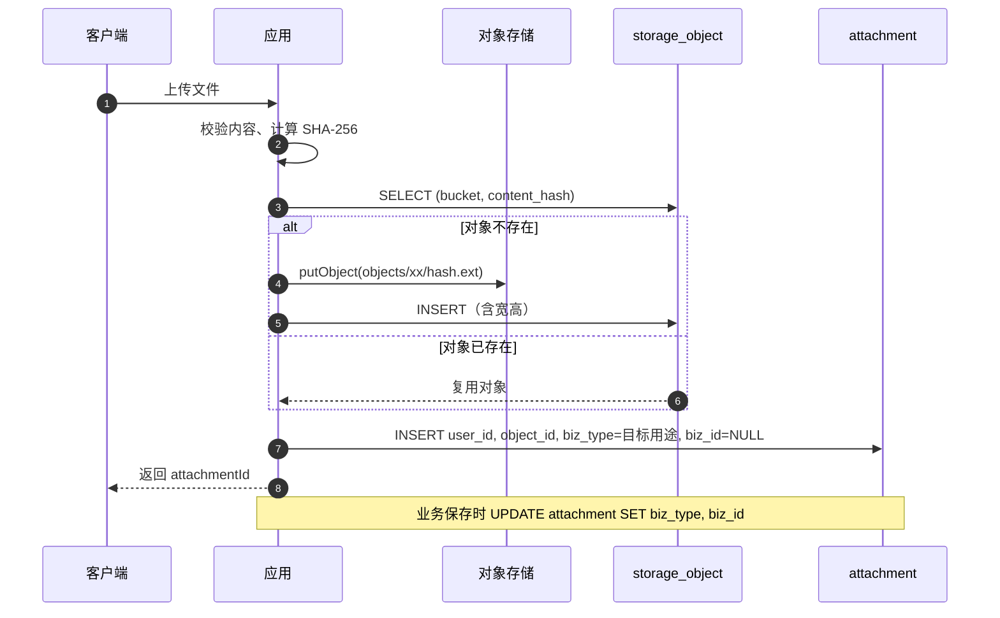
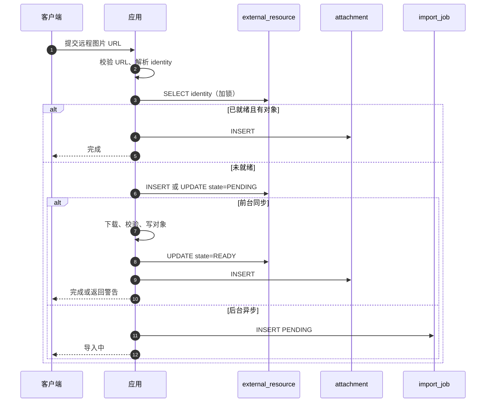
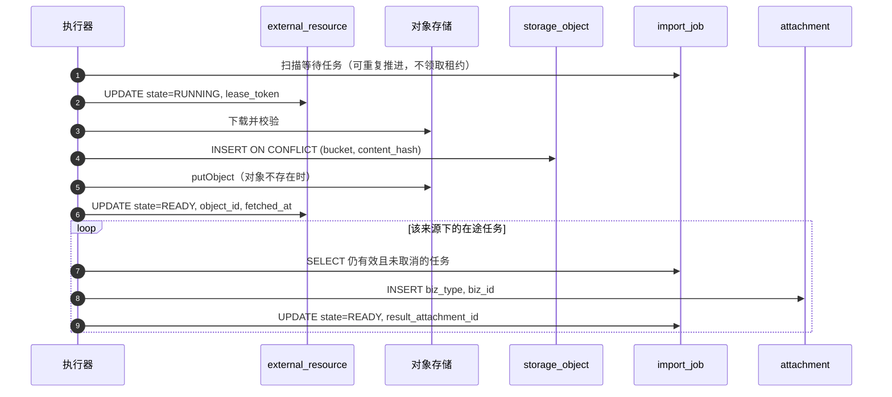
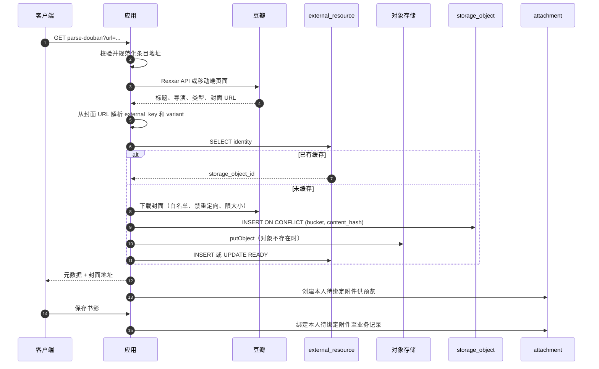
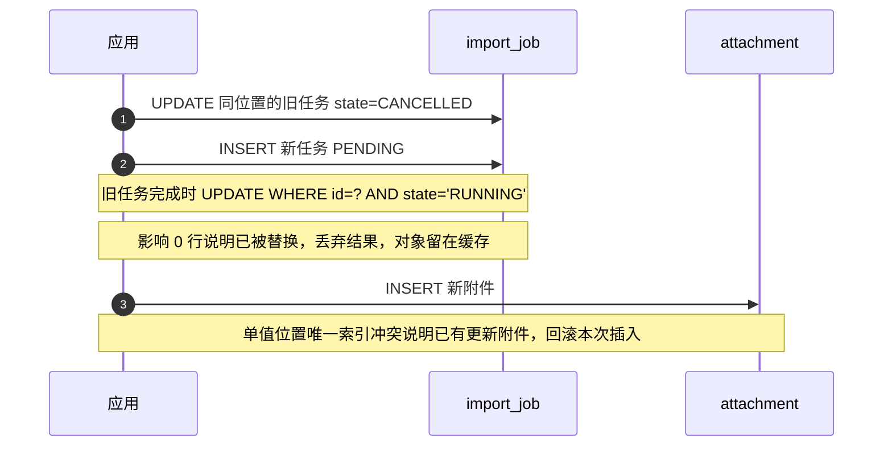
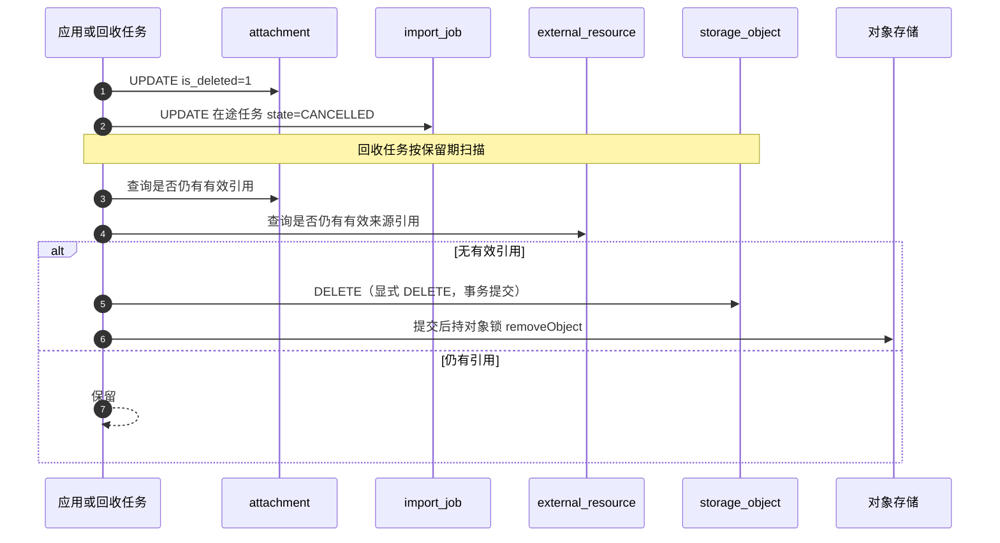
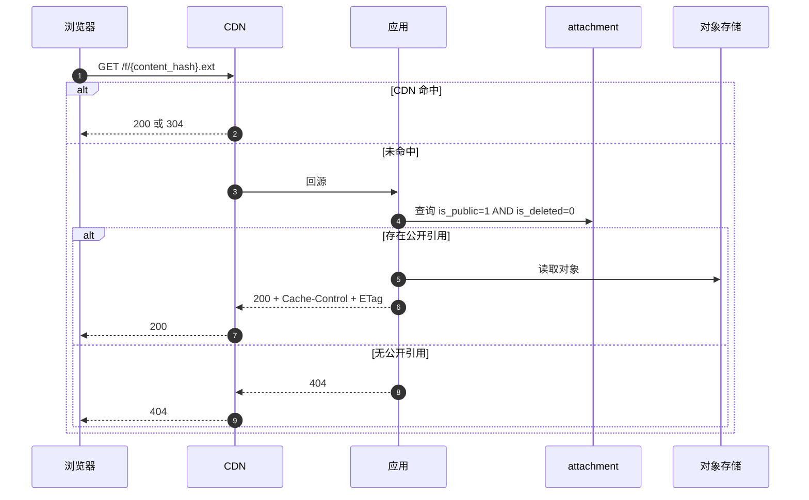

# 附件与来源表设计（目标方案）

编写日期：2026-11-14；修订日期：2026-11-16。状态：实施方案；2026-11-16 开始按本次确认规则落地。建表和增量以 `V20261116_10`、`V20261116_11` 为执行入口，已有库需先准备真实对象字节；尚未执行实际环境迁移。

范围：附件（上传、预览、下载、删除）、外部来源（豆瓣、B 站、京东、淘宝）与远程导入。其他业务表只调整引用方式，不重新设计。

## 1. 设计目标

| 目标 | 具体要求 |
| --- | --- |
| 字节唯一 | 同一份内容全库只存一次，跨用户共享 |
| 来源唯一 | 同一个远程资源只下载一次，成功后再复用它 |
| 归属清晰 | 附件的拥有者、可见性和业务绑定各是一个字段，不互相兼任 |
| 权限与缓存分离 | 共享缓存不带用户信息，权限判断只看附件行 |
| 业务表干净 | 业务表不存远程 URL、下载状态和版本号 |
| 可回收 | 未被引用的字节有明确判定条件和回收路径 |
| 公共可缓存 | 公开附件使用内容寻址地址和 ETag，每次使用前协商验证；私有附件禁止缓存 |
| 可演进 | 新增平台只加枚举值和解析器，新增资源类型只加常量 |

## 2. 模型总览

四张表，按"字节 → 来源 → 附件 → 导入任务"分层：

| 表 | 一句话职责 | 行数关系 |
| --- | --- | --- |
| `storage_object` | 不可变的物理字节 | 一个对象被多个附件、多个来源引用 |
| `external_resource` | 一个远程资源的下载缓存与状态 | 一个来源指向一个对象；一个对象可对应多个来源 |
| `attachment` | 某个用户把某个对象用在哪里 | 一个附件指向一个对象，可选指向一个来源 |
| `import_job` | 一次"把远程资源取回来并挂到某处"的请求 | 一个任务指向一个来源，成功后产出一个附件 |

关系：

- `storage_object` 1 : N `external_resource`
- `storage_object` 1 : N `attachment`
- `external_resource` 1 : N `attachment`（可空）
- `external_resource` 1 : N `import_job`
- `attachment` 0..1 : 1 `import_job`（任务成功后回填结果）

为什么不把来源并入对象：同一个对象可能由多个来源产生（例如用户本地上传的图和豆瓣下载的图内容相同），来源身份是 N，对象是 1，不能合并。

为什么不把任务并入来源：来源是跨用户共享的下载缓存，任务是某个业务位置的一次请求；两者生命周期不同，替换封面时任务会被取消，但缓存对象必须保留给其他用户。

## 3. 表设计

### 3.1 `storage_object` —— 物理字节

| 字段 | 类型 | 必填 | 默认值 | 说明 |
| --- | --- | --- | --- | --- |
| `id` | bigint | 是 | — | 主键，雪花 ID |
| `content_hash` | char(64) | 是 | — | 内容摘要，使用 SHA-256 算法，64 位小写十六进制 |
| `bucket` | varchar(63) | 是 | — | 存储桶 |
| `object_key` | varchar(255) | 是 | — | 对象键，内容寻址：`objects/` + `content_hash` 前两位 + `/` + `content_hash` + 扩展名 |
| `file_size` | bigint | 是 | — | 字节数 |
| `content_type` | varchar(100) | 是 | — | 服务端检测出的真实 MIME |
| `image_width` | integer | 否 | — | 图片宽度（像素）；非图片为空 |
| `image_height` | integer | 否 | — | 图片高度（像素）；非图片为空 |
| `create_user` | bigint | 否 | — | 触发写入的用户；后台任务可为空 |
| `create_time` | timestamp(0) | 是 | CURRENT_TIMESTAMP | 首次写入时间 |
| `update_user` | bigint | 否 | — | 最后更新人；仅元数据修正时写入 |
| `update_time` | timestamp(0) | 是 | CURRENT_TIMESTAMP | 最后更新时间 |
| `is_deleted` | smallint | 是 | 0 | 0 未删除，1 已删除；本表不使用逻辑删除，恒为 0 |

| 约束或索引 | 定义 | 目的 |
| --- | --- | --- |
| 主键 | `id` | — |
| 唯一 | `(bucket, content_hash)` | 同一份内容只存一行 |
| 唯一 | `(bucket, object_key)` | 对象键不重复 |
| 检查 | `file_size > 0` | 拒绝空对象 |
| 检查 | `content_hash` 匹配 `^[0-9a-f]{64}$` | 拒绝空串、MD5 和非法摘要 |
| 检查 | `image_width`、`image_height` 为空或大于 0 | 防止写入无效尺寸 |

规则：

- **内容不可变**：摘要、对象键、大小和 MIME 写入后不再修改；内容变了就是另一个对象。宽高回填、MIME 纠正等元数据修正更新 `update_user/update_time`。
- **写入校验、读取流式返回**：上传和远程导入按真实字节校验一次，将 MIME 与宽高写入对象；预览完成权限检查后按已确认的栅格 MIME 返回原始字节，不再次解码、不重复套用上传像素预算。未知或不支持的类型仅下载，不能使用客户端 MIME 或展示文件名决定内联类型。
- **摘要字段名用 `content_hash`，注释写明使用 SHA-256**：算法写在注释和对象键规则里，不写进列名；换算法必须走迁移并重建对象键，不能在同一列混存不同摘要；`char(64)` 约束长度，避免写入空串或 MD5。
- **无归属**：不存 `user_id`。谁上传的不影响谁可以访问，访问只由 `attachment` 决定。
- **无扩展名语义推断**：扩展名由检测结果决定，不采纳客户端文件名。
- **统一桶**：所有对象写入同一个业务桶，`bucket` 列保留用于将来按用途分桶。分桶会让同一份内容在不同桶各存一份，去重失效。
- **不使用逻辑删除**：`is_deleted` 按实体规范保留并恒为 0，不参与对象生命周期。回收时用 Mapper 显式 `DELETE` 物理删除对象行；不能调用 `removeById`，否则会按 `@TableLogic` 改成置 1，行永远留着。
- **回收**：没有任何有效附件和有效来源引用、且创建超过保留期后，删除桶内文件并物理删除对象行。

### 3.2 `external_resource` —— 远程来源

| 字段 | 类型 | 必填 | 默认值 | 说明 |
| --- | --- | --- | --- | --- |
| `id` | bigint | 是 | — | 主键，雪花 ID |
| `platform` | varchar(32) | 是 | — | `douban`、`bilibili`、`jd`、`taobao` |
| `resource_type` | varchar(32) | 是 | — | `movie_poster`、`book_cover`、`video_cover`、`product_image` 等 |
| `external_key` | varchar(255) | 是 | — | 平台侧稳定标识，服务端从校验后的 URL 解析 |
| `variant` | varchar(128) | 是 | 空串 | 尺寸或裁剪变体，如豆瓣 `s_ratio_poster` |
| `source_url` | varchar(1000) | 是 | — | 下载地址，仅追溯与失败重试，不参与身份；成功后不再抓取 |
| `storage_object_id` | bigint | 否 | — | 成功对象；成功后固定复用，为空表示从未成功下载 |
| `state` | varchar(16) | 是 | `PENDING` | 首次抓取或失败重试状态 |
| `attempts` | integer | 是 | 0 | 连续失败次数；成功或失败后的显式重试归零 |
| `next_attempt_at` | timestamp(0) | 否 | — | 下次可尝试时间；退避用 |
| `lease_token` | varchar(32) | 否 | — | 当前执行租约令牌 |
| `lease_until` | timestamp(0) | 否 | — | 租约到期时间 |
| `error_code` | varchar(64) | 否 | — | 最近一次失败码 |
| `fetched_at` | timestamp(0) | 否 | — | 最近一次成功下载时间 |
| `create_user` | bigint | 否 | — | 首次触发下载的用户，仅审计 |
| `create_time` | timestamp(0) | 是 | CURRENT_TIMESTAMP | 创建时间 |
| `update_user` | bigint | 否 | — | 最后更新人 |
| `update_time` | timestamp(0) | 是 | CURRENT_TIMESTAMP | 最后更新时间 |
| `is_deleted` | smallint | 是 | 0 | 0 有效；成功来源不按远端状态或时间置为失效 |

`state` 取值：

| 值 | 含义 | `storage_object_id` |
| --- | --- | --- |
| `PENDING` | 已登记，等待下载或失败后重试 | 为空 |
| `RUNNING` | 有执行者持有租约 | 为空 |
| `READY` | 下载成功，持续复用 | 必填 |
| `FAILED` | 下载失败，按退避或显式重试 | 为空 |

| 约束或索引 | 定义 | 目的 |
| --- | --- | --- |
| 主键 | `id` | — |
| 唯一 | `(platform, resource_type, external_key, variant)` | 一个远程资源只有一条缓存 |
| 索引 | `(storage_object_id)` | 对象回收时反查 |
| 索引 | `(state, next_attempt_at)` | 扫描待执行资源 |
| 检查 | `platform` 属于固定集合 | 平台码与安全策略绑定 |
| 检查 | `state` 属于四个取值 | 防止写入未定义状态 |
| 检查 | `is_deleted = 0` | 成功来源不失效 |

规则：

- **成功后持续复用**：`READY` 与非空 `storage_object_id` 同时成立；不设成功来源缓存过期时间，不再次探测远端或主动刷新。
- **跨用户共享**：不存 `user_id`、不存可见性。任何用户命中同一条记录都直接复用对象。
- **失败保留**：下载失败不删除记录，按 `attempts` 和 `next_attempt_at` 退避；连续失败达到上限后置 `FAILED`，等用户显式重试。
- **失败**：404 等下载失败进入重试规则，不使已成功的来源失效；已成功来源不再访问远端。
- **重试**：仅未成功的来源允许重试，重新置 `PENDING`、`attempts` 归零；成功来源不得通过重试入口重新下载。

### 3.3 `attachment` —— 用户附件

| 字段 | 类型 | 必填 | 默认值 | 说明 |
| --- | --- | --- | --- | --- |
| `id` | bigint | 是 | — | 内部主键，雪花 ID；业务 API 不对外暴露 |
| `file_key` | uuid | 是 | — | 安全随机 UUIDv4；带连字符的小写字符串，作为所有对外附件标识 |
| `user_id` | bigint | 否 | — | 归属用户；为空表示系统资源 |
| `storage_object_id` | bigint | 有效附件必填 | — | 指向物理字节；已删除的历史缺失上传可为空，由 CHECK 阻止有效附件无对象 |
| `external_resource_id` | bigint | 否 | — | 来源；为空表示本地上传或系统生成 |
| `biz_type` | varchar(50) | 是 | — | 使用位置类型，按附件用途粒度命名，取值见下表 |
| `biz_id` | bigint | 否 | — | 业务记录 ID；上传待绑定或已解绑时为空 |
| `is_public` | smallint | 是 | 0 | 0 私有，1 允许匿名访问；只由服务端按 `biz_type` 设置 |
| `file_name` | varchar(255) | 否 | — | 下载时展示的文件名；图片可为空 |
| `sort_order` | integer | 是 | 0 | 同一业务多条附件时的顺序 |
| `create_user` | bigint | 否 | — | 创建人 |
| `create_time` | timestamp(0) | 是 | CURRENT_TIMESTAMP | 创建时间 |
| `update_user` | bigint | 否 | — | 更新人 |
| `update_time` | timestamp(0) | 是 | CURRENT_TIMESTAMP | 更新时间 |
| `is_deleted` | smallint | 是 | 0 | 0 有效，1 已解除或删除 |

`biz_type` 取值：

| 值 | 语义 | 是否单值 |
| --- | --- | --- |
| `movie_cover` | 影视封面 | 是 |
| `read_cover` | 阅读封面 | 是 |
| `device_cover` | 设备图片 | 是 |
| `wardrobe_item_cover` | 衣物图片 | 是 |
| `b_video_cover` | B 站视频封面 | 是 |
| `avatar` | 用户头像 | 是 |
| `bank_card_face` | 银行卡卡面 | 是 |
| `bank_card_template_face` | 公共卡面模板 | 是 |
| `feedback` | 反馈附件 | 否，按 `sort_order` |
| `feedback_comment` | 反馈评论附件 | 否，按 `sort_order` |
| `honor_record` | 荣誉附件 | 否，按 `sort_order` |
| `event_record` | 活动附件 | 否，按 `sort_order` |
| 待绑定 | 用途已由上传入口确定，`biz_id` 为空；沿用对应业务的私有授权 | — |

单值类型进入部分唯一索引的白名单；新增单值业务时同时增加常量和迁移。未列出的类型默认允许多行。

| 约束或索引 | 定义 | 目的 |
| --- | --- | --- |
| 主键 | `id` | — |
| 唯一（部分） | `(biz_type, biz_id)`，限 `is_deleted = 0` 且 `biz_id IS NOT NULL` 且 `biz_type` 属于上表单值类型 | 单值位置只能有一条有效附件 |
| 索引 | `(biz_type, biz_id, is_deleted)` | 按业务批量取附件 |
| 索引 | `(user_id, is_deleted)` | 个人文件列表 |
| 索引 | `(storage_object_id)` | 对象回收时反查 |
| 索引（部分） | `(storage_object_id)`，限 `is_public = 1` 且 `is_deleted = 0` | 公共访问时判断对象是否有公开引用 |
| 索引 | `(external_resource_id)` | 来源追溯 |
| 检查 | `is_public in (0, 1)` | — |
| 检查 | `is_deleted in (0, 1)` | — |

规则：

- **一行只服务一个使用位置**。同一张图给两条业务用就是两行附件，字节仍只有一份。
- **单值位置按 `(biz_type, biz_id)` 唯一**，替换时先软删旧行再插新行，同一事务内完成。
- **系统资源**：`user_id` 为空，例如公共卡面模板；`is_public` 由服务端设置。
- **公开只由服务端判定**：`is_public = 1` 只对当前头像、已发布卡面模板等明确匿名的业务设置，客户端不能自行把附件改为公开。
- **私有读取**：要求登录、是 `user_id` 本人，并通过该业务对应的菜单锁；管理员可按管理职责读取反馈等业务附件。
- **业务附加规则**：B 站封面还要求当前视频引用该附件；银行卡卡面要求卡片归属；卡面模板要求模板已发布或对该用户可见。这些规则由对应业务 Guard 执行，附件服务只提供归属和可见性判断。
- **访问地址按可见性区分**：公开附件返回内容寻址的公开地址，可由 CDN 缓存；私有附件返回带鉴权的私有地址，禁止共享缓存。规则见第 6 节。
- **不存对象键、大小、MIME、哈希**，这些只在 `storage_object`。

### 3.4 `import_job` —— 远程导入任务

| 字段 | 类型 | 必填 | 默认值 | 说明 |
| --- | --- | --- | --- | --- |
| `id` | bigint | 是 | — | 主键，雪花 ID |
| `biz_type` | varchar(50) | 是 | — | 目标业务类型，取值与附件一致 |
| `biz_id` | bigint | 是 | — | 目标业务记录 ID |
| `external_resource_id` | bigint | 是 | — | 要取用的远程资源 |
| `state` | varchar(16) | 是 | `PENDING` | 任务状态 |
| `next_attempt_at` | timestamp(0) | 否 | — | 下次可检查时间 |
| `error_code` | varchar(64) | 否 | — | 最近一次失败码 |
| `result_attachment_id` | bigint | 否 | — | 成功产出的附件 |
| `create_user` | bigint | 否 | — | 发起用户 |
| `create_time` | timestamp(0) | 是 | CURRENT_TIMESTAMP | 创建时间 |
| `update_user` | bigint | 否 | — | 更新人 |
| `update_time` | timestamp(0) | 是 | CURRENT_TIMESTAMP | 更新时间 |
| `is_deleted` | smallint | 是 | 0 | 保留期清理用 |

`state` 取值：

| 值 | 含义 |
| --- | --- |
| `PENDING` | 等待来源可用或被领取 |
| `RUNNING` | 正在等待来源下载完成 |
| `READY` | 已产出附件并挂到目标位置 |
| `FAILED` | 来源连续失败或目标校验不通过 |
| `CANCELLED` | 目标位置被更新的请求替换，或目标业务已删除 |

| 约束或索引 | 定义 | 目的 |
| --- | --- | --- |
| 主键 | `id` | — |
| 唯一（部分） | `(biz_type, biz_id)`，限 `state in ('PENDING', 'RUNNING')` 且 `is_deleted = 0` | 同一位置同时只有一个在途导入 |
| 索引 | `(state, next_attempt_at)` | 扫描待执行任务 |
| 索引 | `(external_resource_id)` | 来源完成时批量推进任务 |
| 索引 | `(biz_type, biz_id, create_time)` | 页面查询导入进度 |
| 检查 | `state` 属于五个取值 | — |
| 检查 | `is_deleted in (0, 1)` | — |

规则：

- **任务只表达"这个位置要这张图"**，下载状态在 `external_resource`，避免每个用户重复下载。
- **并发**：任务在同一位置唯一；来源下载由租约保证只有一个执行者。
- **替换**：新请求到达时，旧任务置 `CANCELLED`，新任务插入；旧任务完成时用条件更新校验自己仍是有效任务，不是就丢弃结果（对象仍留在缓存）。
- **取消**：目标业务删除时，相关在途任务置 `CANCELLED`，不删除已产出的附件。
- **多附件限制**：任务按 `(biz_type, biz_id)` 唯一，当前只支持单值位置的一次导入。如果以后多附件业务要并发导入多张远程图片，需要给任务增加目标槽位（如 `sort_order` 或独立 `target_key`），不能直接复用当前唯一键。

适用业务：

| 业务 | 使用方式 |
| --- | --- |
| B 站视频封面 | 异步任务；失败重试，同一视频换封面时取消旧任务 |
| 豆瓣影视、书籍封面 | 前台同步导入，成功建待绑定附件供鉴权预览；失败返回警告，来源记录失败供重试 |
| 京东、淘宝商品图 | 当前由用户上传，不建任务；将来自动抓图时按异步任务接入 |
| 本地头像、卡面、普通附件 | 不建任务 |

任务只在异步或重试场景出现；能在请求内完成的导入不写任务行。

## 4. 来源身份规则

### 4.1 平台与资源类型

| `platform` | 当前来源 | URL 白名单 | 典型 `resource_type` |
| --- | --- | --- | --- |
| `douban` | 豆瓣影视、书籍封面 | 豆瓣图片 CDN 域名及子域 | `movie_poster`、`book_cover` |
| `bilibili` | B 站视频封面 | B 站图片 CDN 域名及子域 | `video_cover` |
| `jd` | 京东商品图 | 京东图片 CDN 域名及子域 | `product_image` |
| `taobao` | 淘宝商品图 | 淘宝图片 CDN 域名及子域 | `product_image` |

### 4.2 `external_key` 解析

统一规则：只保留 URL 路径中区分资源的稳定段，去掉协议、主机、查询串和 fragment；由服务端从校验通过的 URL 解析，不接受客户端传入，避免缓存投毒。

| 平台 | 输入示例 | `external_key` | `variant` |
| --- | --- | --- | --- |
| 豆瓣 | `https://img.doubanio.com/view/photo/s_ratio_poster/public/p480747492.jpg` | `p480747492` | `s_ratio_poster` |
| B 站 | `https://i0.hdslb.com/bfs/archive/ab12cd34.jpg` | `bfs/archive/ab12cd34` | 空串 |
| 京东 | `https://img14.360buyimg.com/n1/jfs/t1/xxxx.jpg?expires=...&sign=...` | `jfs/t1/xxxx` | `n1` |
| 淘宝 | 按实际 CDN 路径 | 路径稳定段 | 尺寸段 |

不能用整串 URL 当身份：签名会过期、CDN 主机轮换、尺寸段不同，整串当键会导致同一张图永远命中不到。

`variant` 是平台对同一张图的规格标识（尺寸、裁剪或质量档位），来自 URL 里的规格段，不是我们自己的裁剪参数。豆瓣同一张海报的 `s_ratio_poster`（小图）和 `l_ratio_poster`（大图）内容不同，但都属于同一个 `external_key`：分开记录才能各自缓存、互不覆盖。平台只有一种规格时为空串，空串仍然参与唯一键。取值由服务端解析，业务场景需要哪个规格由服务端固定选择，不接受前端随意传值。

### 4.3 安全边界

| 规则 | 要求 |
| --- | --- |
| 协议 | 只允许 HTTPS |
| 主机 | 只允许该平台配置的域名及子域，禁止 userinfo |
| 重定向 | 禁止跟随 |
| 端口 | 只允许默认 443 |
| 大小 | 读取上限 10 MiB，超限中断 |
| 内容 | 按真实字节解码校验图片格式，不信任 `Content-Type` |
| 解析 | `external_key` 必须来自校验后的 URL；客户端只能传 URL |

## 5. 生命周期

### 5.1 附件

| 动作 | 规则 |
| --- | --- |
| 上传 | 落 `storage_object` 后插入对应用途附件，`biz_id` 为空、`is_public = 0`；头像或模板保存后才能公开 |
| 绑定 | 更新 `biz_type`、`biz_id`；单值位置受唯一索引约束 |
| 替换 | 同一事务内软删旧附件、插入新附件 |
| 解绑 | 置 `biz_id = NULL`，附件仍属于用户 |
| 删除业务 | 软删该业务的有效附件；对象与来源保留 |
| 删除用户 | 注销任务物理删除本人附件；系统资源保留，详见 5.5 |

### 5.2 对象回收

| 判定 | 处理 |
| --- | --- |
| 仍被任一有效附件引用 | 保留 |
| 仍被任一有效来源引用 | 保留 |
| 仅被已软删附件引用，且对象创建超过保留期 | 删除桶内文件并物理删除对象行 |
| 上传成功但从未绑定或已解绑，且附件最后修改超过 7 天 | 先将附件置为已删除，再按无引用对象规则回收 |

不按"引用计数"字段维护，直接反查两张表，避免计数漂移。已软删的附件和已失效的来源不阻止回收；对象删除后这些历史行只保留元数据，不再能预览或下载，业务查询必须只取有效附件。

### 5.3 任务与来源

| 场景 | 处理 |
| --- | --- |
| 来源不存在 | 新建 `PENDING` 来源和 `PENDING` 任务 |
| 来源已就绪 | 直接插入附件，不建任务 |
| 来源下载中 | 只建任务，不重复下载 |
| 来源失败且未超过上限 | 建任务，等待退避后重试 |
| 来源连续失败超过上限 | 来源置 `FAILED`，任务置 `FAILED`，等待显式重试 |
| 用户更换来源 | 取消旧任务，按新来源身份复用成功对象或创建等待任务 |
| 用户重试失败来源 | 仅无成功对象时重新排队；成功来源保持 `READY` |

### 5.4 来源与任务的清理

| 对象 | 判定 | 处理 |
| --- | --- | --- |
| 来源 | 已就绪，无论是否被附件引用 | 持续保留并复用，不按时间过期 |
| 来源 | 从未成功且无在途任务、无执行租约，超过保留期 | 可物理删除 |
| 任务 | 完成、取消或已被后续请求替代的失败任务，超过 30 天 | 物理删除；最新失败任务保留 |

任务是异步请求的状态与失败重试载体。完成和取消任务超过 30 天后可清理；最新失败任务保留供用户重试，存在更晚请求时才可清理旧失败任务。

### 5.5 账号注销

| 步骤 | 处理 |
| --- | --- |
| 附件 | 物理删除 `user_id = 注销用户` 的 `attachment`，不做逻辑删除 |
| 任务 | 物理删除该用户发起或目标属于该用户的 `import_job` |
| 对象 | 注销事务先提交引用删除，再由统一回收器清理无引用对象；成功来源的共享对象继续保留 |
| 共享行 | `storage_object`、`external_resource` 和系统附件中等于注销用户的 `create_user/update_user` 均置空 |
| 系统资源 | `user_id` 为空的公共卡面模板等保留 |
| 头像 | 随 `attachment` 删除；`sys_user.avatar_file_id` 已在 `V20261115_01` 移除 |

注销清理在同一个幂等任务里执行，失败保留任务和资源索引供重试；不能只软删附件，也不能因为对象被共享就把 `create_user` 留在共享行上。

## 6. 公共访问与 CDN 缓存

公开附件和私有附件走两条不同的地址，缓存策略由可见性决定，不由调用方决定。

### 6.1 两类访问地址

| 类型 | 地址 | 鉴权 | CDN | 说明 |
| --- | --- | --- | --- | --- |
| 公开附件 | `/f/{content_hash}.{扩展名}` | 无；源站只校验"该对象存在有效公开附件"（仅当前头像、已发布卡面模板） | 缓存 | 内容寻址，同一对象全局一个地址；URL 位于应用 API 前缀下 |
| 私有附件 | `/api/file/preview/{fileKey}` | Bearer；`` 场景沿用现有 Cookie / URL token 回退 | 不缓存 | 地址含附件 ID，便于逐行授权 |
| 系统公共资源 | `/f/{content_hash}.{扩展名}` | 无 | 缓存 | 银行卡公共卡面等无归属资源 |

公开地址用内容摘要而不是附件 ID：同一张公共图被多条业务引用时，CDN 只存一份；内容变化时摘要变化，地址随之变化，不需要清理旧缓存。私有地址用附件 ID：授权必须按附件行判断，不能按内容判断。

匿名白名单只有 `avatar` 和 `bank_card_template_face`：其他 `biz_type` 即使 `is_public = 1` 也不进入公开地址，避免普通业务附件被误发布到 CDN。头像只认当前有效的那一条；换头像后旧附件软删，旧地址不再通过源站校验。

### 6.2 公开判定

| 场景 | 结果 |
| --- | --- |
| 对象至少被一条有效附件引用、`is_public = 1` 且 `biz_type` 属于匿名白名单 | 公开地址可访问 |
| 对象的公开附件全部删除或转为私有 | 源站重新校验后返回 404，不返回 304 |
| 同一对象既有公开附件又有私有附件 | 两条地址都可访问；私有附件仍返回私有地址 |
| 对象只被私有附件引用 | 公开地址返回 404，摘要不对外暴露 |
| 附件是已被替换的旧头像 | 旧附件解除公开绑定；无其他有效公开引用时源站拒绝访问 |
| 卡面模板已停用或所属银行字典停用 | 按模板发布规则判定；公开判定必须与业务发布规则一致，不能只看附件是否存在 |

同一份字节同时被公开和私有附件引用时，字节本身已经是公开内容，不构成额外的信息泄露；用户与附件的关联仍只存在于私有地址和数据库中。

匿名公开路径不能执行菜单锁和用户级可见性判断。要求菜单锁或按用户过滤的资源（银行卡卡面、B 站封面等）一律不能标记为 `is_public`，只能走私有地址；否则 CDN 会绕过业务授权。

### 6.3 响应头

| 响应头 | 公开附件 | 私有附件 |
| --- | --- | --- |
| `Cache-Control` | `public, no-cache` | `private, no-store` |
| `ETag` | 对象 `content_hash` | 不依赖缓存，使用 `private, no-store` |
| `Content-Type` | `storage_object.content_type` | 同左 |
| `X-Content-Type-Options` | `nosniff` | `nosniff` |
| `Content-Security-Policy` | `default-src 'none'; sandbox` | 同左 |
| `Content-Disposition` | 图片 `inline`，其余 `attachment` | 同左 |
| `Access-Control-Allow-Origin` | `*` | 不设置 |

- 公开地址的扩展名必须与 `storage_object.content_type` 一致，不一致直接 404；避免用错误后缀绕过内容检测。

- 公开响应不带 `Set-Cookie`，不依赖 `Authorization`，因此不需要 `Vary`。
- 私有响应禁止任何共享缓存；CDN 配置对 `/api/` 前缀默认不缓存。
- `If-None-Match` 命中时返回 304，源站不重复读对象存储。
- 公开地址只允许内联图片；HTML、SVG、PDF 等一律按附件下载，避免公开地址成为 XSS 入口。

### 6.4 CDN 拓扑

| 方案 | 回源 | 优点 | 代价 |
| --- | --- | --- | --- |
| CDN 回源应用公开接口（推荐） | 应用 | 公开判定、撤销、内容安全都在应用内；桶不需要公开 | 缓存未命中经过应用 |
| CDN 直连对象存储的公开前缀 | 对象存储 | 未命中不占应用 | 桶策略必须只开放公开前缀；删除和撤销不可控 |

推荐前者。缓存未命中才访问应用，命中时只有 CDN。后续流量增大，再单独建只放公开对象的桶，并限制 CDN 只能访问该桶。

公开地址的实现边界：

- 必须加入鉴权白名单，只允许 GET，只接受 `/f/{content_hash}.{扩展名}` 形式，不提供目录、列表或按 ID 读取。
- 在 CDN 侧开启限速和防爬；源站只承担回源，不直接面对公开流量。
- 公开地址不返回任何用户、业务或附件信息，响应体只有字节。

### 6.5 内容更新与公开撤销

- 当前公开响应为 `public, no-cache`：浏览器可以保留字节，但每次使用前需向源站确认；服务器先检查公开资格，再处理 ETag，避免已撤销内容通过 304 放行。
- 更换头像会解除旧附件的公开绑定；若相同字节仍被其他有效公开附件引用，内容地址继续有效，因为该地址代表字节而非某个用户。
- 当前不接入长时间 CDN 缓存，不增加 CDN 清理接口；源站撤销只约束后续请求，无法收回已经下载的副本。
- 来源复用与 HTTP 缓存无关：成功来源不设过期时间、不主动刷新，失败允许重试。

### 6.6 表结构影响

| 项目 | 结论 |
| --- | --- |
| `storage_object` 新增公开标记 | 不需要；判定时查附件，避免共享行被频繁更新 |
| 新增索引 | `attachment (storage_object_id)`，限 `is_public = 1` 且 `is_deleted = 0` |
| 公开资格缓存 | 当前不增加缓存，直接校验有效附件及业务发布状态 |
| 私有签名地址 | 不做。私有文件只在应用内鉴权后流式返回，避免签名泄露和过期问题 |

### 6.7 不复用原站 CDN 直链

豆瓣、B 站、京东的图片 CDN 有防盗链、Referer 校验和签名过期，直链会随机失效，也让展示依赖第三方。首次抓取后存入自己的对象存储，再由自己的 CDN 缓存；原站地址只保留在 `external_resource.source_url` 作为追溯。

## 7. 写入流程与表更新

### 7.1 表更新速查

| 触发动作 | 写入或更新 | 保持不动 |
| --- | --- | --- |
| 本地上传 | `storage_object`（首次内容 INSERT）、`attachment`（INSERT） | `external_resource`、`import_job` |
| 业务保存或绑定 | `attachment`（UPDATE `biz_type`、`biz_id`） | 其他表 |
| 远程导入，来源已就绪 | `attachment`（INSERT） | `external_resource`、`import_job` |
| 远程导入，同步成功 | `external_resource`（INSERT 或 UPDATE 为 `READY`）、`storage_object`（INSERT）、`attachment`（INSERT） | `import_job` |
| 远程导入，转异步 | `external_resource`（INSERT 或 UPDATE 为 `PENDING`）、`import_job`（INSERT） | `attachment`，等执行器完成 |
| 异步执行成功 | `storage_object`（INSERT）、`external_resource`（UPDATE `READY`）、`attachment`（INSERT）、`import_job`（UPDATE `READY`） | — |
| 替换封面 | `import_job`（旧任务 `CANCELLED`、新任务 INSERT）、`attachment`（旧行软删、新行 INSERT） | `storage_object`、`external_resource` |
| 删除业务 | `attachment`（UPDATE `is_deleted = 1`）、`import_job`（在途任务 `CANCELLED`） | `storage_object`、`external_resource` |
| 对象回收 | `storage_object`（显式 DELETE）、对象存储 | `attachment`、`external_resource` 保留 |
| 公开访问 | 无写入 | — |

### 7.2 本地上传

- 事务回滚不删除桶内对象：对象可能已被其他用户的附件引用。
- 上传后未绑定的附件按保留期回收，不影响其他用户。
- **摘要只由服务端计算**：客户端不上传、不计算哈希，也不参与对象身份。`content_hash` 必须来自服务端实际收到的字节，否则客户端可以冒用已有对象或制造哈希与内容不一致的记录。
- **不做"先查哈希再上传"**：那会变成一个探测接口，能判断某个内容是否已存在，私有附件场景会泄露信息。相同内容上传时由服务端去重复用即可。

### 7.3 远程导入

请求阶段：

执行阶段（异步）：

- 同步导入失败只返回警告，不写 `import_job`。
- 异步导入失败按退避更新 `external_resource` 和 `import_job`，不产出附件。
- 只有来源领取下载租约；任务可重复扫描推进。任务发布与更换、清空、删除统一先锁业务记录再锁任务，在同一事务内检查任务有效性、替换附件并写入结果。

### 7.4 豆瓣封面导入

豆瓣书影入口只接收条目地址，元数据解析和封面存储分成两段，封面不进入业务表。

**第一段：地址校验与元数据解析，不碰附件表**

| 步骤 | 内容 |
| --- | --- |
| 入口 | `GET /api/record/movie/parse-douban?url=`、`GET /api/record/read/parse-douban?url=` |
| 地址校验 | 只接受 `movie.douban.com`、`book.douban.com` 的 `/subject/{id}/`；拒绝端口和 userinfo；规范化为 HTTPS 地址 |
| 主路径 | 移动端 Rexxar API `m.douban.com/rexxar/api/v2/{movie\|tv}/{id}`，取标题、导演、类型、集数或时长、`pic.large` 封面 |
| 降级路径 | 抓取 `m.douban.com/movie/subject/{id}/` 页面，带移动端 UA 和随机 `bid` Cookie；先解析 JSON-LD，再回退 `og:image`、`#mainpic` |
| 解析失败 | 标题仍为空时提示用户手动填写，不进入封面流程 |

**第二段：封面解析与入库**

| 步骤 | 表操作 |
| --- | --- |
| 从封面 URL 解析身份 | 无；`platform = douban`、`resource_type = movie_poster` 或 `book_cover`、`external_key = 照片 ID`、`variant = l` |
| 查来源 | 按四元身份 SELECT `external_resource` |
| 已缓存 | 复用 `storage_object_id`，不访问豆瓣 CDN |
| 未缓存 | 下载、校验、计算 `content_hash`；INSERT `storage_object`（按 `(bucket, content_hash)` 冲突时复用）；写入对象存储；INSERT 或 UPDATE `external_resource` 为 `READY` |
| 预览或表单回显 | 创建归属当前用户的待绑定附件，返回附件 ID 与鉴权地址 |
| 保存书影 | 将本人待绑定附件绑定至书影；跨业务复用时另建附件，不迁走原绑定 |

- 现在把 `s/public` 替换成 `l/public` 的做法，就是选择 `variant`；目标设计把它作为身份的一部分，不再把原始整串 URL 作为缓存身份。
- 预览创建待绑定附件；取消保存的附件按保留期清理，成功来源与对象持续保留供复用。
- 书影表单的 `parse-douban` 允许预热缓存以便立即展示；浏览器采集的 `/capture/douban/preview` 保持"预览不写库"的现行契约，在 commit 时解析封面。
- 同一 subject 或同一封面再次解析时命中 `external_resource`，不重复下载。
- 书影按 subject 的重复校验仍在业务服务内完成（用户行锁加 URL 匹配），不放进附件表。
- 封面下载失败保留 `external_resource` 的失败与重试状态，不创建附件；保存是否可以无封面继续，由调用方按现有契约决定。

### 7.5 替换与竞态

- 软删旧附件和插入新附件在同一事务内完成。
- 被取消的任务即使下载成功，也不创建附件。

### 7.6 删除与回收

- 删除附件不删除对象和来源。
- 对象回收只在没有有效附件、没有有效来源引用且超过保留期时执行。
- 对象行用显式 `DELETE` 物理删除，不能走 `removeById`。
- 写入、复用、建立引用和回收共用 `(bucket, object_key)` 分布式锁，持有至事务完成；回收持锁后重新查对象及有效引用。
- 无引用对象创建超过 7 天后可回收。先提交对象行删除，再在锁释放前删除字节；数据库回滚不删字节，存储删除失败由内容寻址前缀的孤立字节扫描重试。上传回滚遗留的无索引字节也由该扫描处理。
- 最新失败任务不能仅因超过保留期而删除，否则页面会失去失败重试入口。

### 7.7 公开访问

- 回源路径只读，不写任何表。
- 私有附件不走这张图，统一走 `/api/file/preview/{fileKey}` 鉴权后返回 `private, no-store`。

## 8. 关键取舍

| 决策 | 选择 | 理由 |
| --- | --- | --- |
| 字节与附件是否合并 | 分开 | 合并后要么字节重复，要么附件失去单一归属 |
| 来源与对象是否合并 | 分开 | 一个对象可对应多个来源，来源是 N 对 1 |
| 来源与任务是否合并 | 分开 | 来源跨用户共享，任务按业务位置独立取消 |
| 是否建平台字典表 | 不建 | 平台码绑定代码中的白名单和解析器，用检查约束固定 |
| 是否给业务表加 `cover_file_id` | 不加 | 单值位置由唯一索引保证，查询走 `(biz_type, biz_id)` |
| 是否给对象加引用计数 | 不加 | 计数容易漂移，回收时反查两张引用表 |
| 对象是否逻辑删除 | 不使用 | `is_deleted` 按实体规范保留、恒为 0；回收直接物理删除对象行 |
| 主键与对外标识 | 内部 bigint 雪花，附件对外 file_key 为 UUIDv4 | 内部关联保持紧凑稳定，对外附件不暴露主键；随机标识不替代归属与业务鉴权 |
| 是否加外键 | 不加 | 遵循[项目禁止数据库外键的统一规范](SQL脚本规范.md#5-字段与约束设计)；引用有效性、归属和删除规则由服务层维护，回收任务通过引用复查及并发控制保证安全 |
| 公共文件地址 | 内容寻址 `/f/{content_hash}` | 同一对象全局一个地址，CDN 天然复用，内容变化即换地址 |
| 私有文件是否走 CDN | 不走 | 私有授权按附件行判断，共享缓存无法安全表达 |
| 对象是否存公开标记 | 不存 | 公开是附件属性；在共享对象行上维护标记会被并发写入和回收干扰 |
| `is_public` 是否可由客户端设置 | 否 | 只由服务端按 `biz_type` 判定，避免用户把私有图片发布到 CDN |
| 是否保留 `sys_user.avatar_file_id` | 不保留（已由 `V20261115_01` 迁移） | 单值附件已经保证唯一头像；保留指针会形成两处状态，换头像时必须同时改两处 |

## 9. 与现有实现的映射

| 现有对象 | 目标对象 | 处理 |
| --- | --- | --- |
| `file` | `attachment` | 字段按 3.3 重建；`file.id` 的 UUID 改为 bigint |
| `file` 的归属（现由 `create_user` 承担） | `attachment.user_id` | 从 `create_user` 回填，无法确定时人工核对 |
| `file.storage_object_id` | `attachment.storage_object_id` | 必填；历史行先补齐对象 |
| `file.file_name/file_size/file_type/hash_value` | `storage_object` + `attachment.file_name` | 物理路径与真实元数据迁入对象；附件只保留下载展示文件名 |
| `file.biz_type/biz_id/is_public` | `attachment` 同义字段 | `biz_type` 按用途取值，如 `movie_cover`、`feedback`；公共卡面模板迁移时 `user_id` 置空 |
| `storage_object` | `storage_object` | 保留；对象键改为内容寻址，新增图片宽高 |
| `image_import_task` | `external_resource` + `import_job` | 下载状态迁到来源，目标与版本语义迁到任务 |
| `b_video.cover` | `external_resource.source_url`、`import_job` | 业务表不再存远程 URL |
| `b_video.cover_file_id` | `attachment` | 此前目标库已直接回填；本次 `V20261116_10` 补齐仍持有旧指针的已有库升级路径，随后统一切换到 `attachment` |
| `b_video.cover_state/cover_version` | `external_resource.state`、任务条件更新 | 删除版本号，用任务状态和唯一索引防止旧结果覆盖 |
| `device.source_platform/source_order_id/source_product_id` | 保留 | 这些是采购业务字段，不是附件来源 |
| `movie.url`、`read_record.url` | 保留 | 用户保存的原站页面链接，不是图片来源 |
| `sys_user.avatar_file_id` | `attachment`（`biz_type = avatar`、`biz_id = sys_user.id`） | 已完成：`V20261115_01` 回填到 `file.biz_type='avatar'`、`file.biz_id=user.id` 后删除列；后续随 `file` → `attachment` 迁移 |
| `PublicImageMapper` 的匿名查询 | `attachment.is_public` + 匿名白名单 + 有效引用 | 不再依赖 `file.storage_object_id IS NULL` 和 `sys_user.avatar_file_id` |
| `FilePreviewGuard` 的菜单锁、管理员和业务校验 | 保留 | 附件服务只判断归属与可见性，菜单锁、视频归属、卡面可见性仍由对应业务 Guard 执行；菜单映射按新的 `biz_type` 更新 |
| `FileAccessService`、`PublicImageService` 的对象读取 | 统一从 `storage_object` 取 bucket、object_key、content_type | 删除 `file.file_name` 后必须切换 |
| `RecordImageService.replace` | 改为插入新 `attachment`，指向同一 `storage_object_id` | 不再复制文件元数据 |
| `VideoCoverService`、`VideoCoverStorage` | 封面完成时复用 `external_resource` 与 `storage_object`，插入 `attachment` | 不再复制文件元数据 |

## 10. 业务表需要的改动

| 表 | 改动 |
| --- | --- |
| `b_video` | 删除 `cover_file_id`（已有库由 `V20261116_10` 检查并回填）；`cover`、`cover_state`、`cover_version` 在迁入 `external_resource` 与导入任务后删除 |
| `movie`、`read_record` | 无结构改动；封面附件 `biz_type = movie_cover` / `read_cover` |
| `device`、`wardrobe_item` | 无结构改动；图片附件 `biz_type = device_cover` / `wardrobe_item_cover` |
| `feedback`、`feedback_comment`、`honor_record`、`event_record` | 无结构改动；附件 `biz_type = feedback` / `feedback_comment` / `honor_record` / `event_record`，允许多行 |
| `sys_user` | 已完成：`avatar_file_id` 已由 `V20261115_01` 删除；头像由 `biz_type = avatar`、`biz_id = sys_user.id` 的单值附件表达 |
| `bank_card`、`bank_card_cover_template` | 无结构改动；卡面附件 `biz_type = bank_card_face` / `bank_card_template_face` |

## 11. 不做的事

- 不建平台表、资源类型表或字典表。
- 不设成功来源缓存过期时间，不提供主动刷新；成功后持续复用，失败可以重试。
- 不做缩略图和多规格派生图；需要时另立对象类型。
- 不维护对象引用计数字段。
- 不在业务表保留冗余封面指针；若列表页出现性能问题再单独评估。
- 不把多附件业务拆成独立关联表；`attachment` 已统一表达。
- 不做私有文件的签名地址或 CDN 缓存；私有访问一律经应用鉴权。
- 不复用原站图片直链；只缓存抓取后的副本。

## 12. 验证

| 项目 | 验证内容 |
| --- | --- |
| 结构 | 四张表约束、部分唯一索引和检查约束在 PostgreSQL 18 实际建表通过 |
| 内容去重 | 同一份字节上传两次只产生一个对象、两条附件 |
| 来源复用 | 同一身份第二次导入不访问远端、不新建对象 |
| 跨用户 | 两个用户引用同一封面：两个附件、一个对象、一条来源 |
| 并发 | 同一来源同一时刻最多一个租约执行者；成功后不再下载；同一位置最多一个在途任务 |
| 替换 | 更换来源期间旧封面仍可用；旧任务完成后不能覆盖新附件 |
| 失败 | 下载失败不产出附件，来源按退避重试 |
| 回滚 | 业务回滚不删除共享对象 |
| 权限 | 跨用户不能预览或绑定私有附件；菜单锁、管理员读取、B 站封面视频归属、卡面模板可见性全部生效 |
| 公开判定 | 只有服务端标记的当前头像和已发布卡面模板可匿名访问；普通私有附件不能通过公开地址读取；旧头像失去公开绑定；无其他公开引用时地址失效 |
| 注销 | 附件和任务物理删除；无引用对象回收；共享对象和来源的 `create_user` 置空；系统模板保留 |
| 安全 | 非白名单域名、重定向、非 HTTPS、超限、伪装图片全部拒绝 |
| 回收 | 无引用对象按保留期物理删除；有引用的对象不被误删 |
| 公共缓存 | 公开地址返回 `public, no-cache` 和 `ETag`；每次重新验证公开资格，内容未变时返回 304 |
| 私有隔离 | 私有地址返回 `private, no-store`；CDN 和浏览器代理不缓存 |
| 公开撤销 | 删除最后一条公开附件后源站返回 404；公开转私有后不再返回公开地址 |
| 混合引用 | 同一对象同时被公开和私有附件引用时，两条地址分别可用且权限互不影响 |
| 公开安全 | 公开地址拒绝非图片内联，不因免鉴权变成通用存储代理 |

结构验证使用 `mvn -f tools/flyway/pom.xml verify`，实体通过真实 PostgreSQL 全字段查询；以上不代表 Web 或移动端已联调。

## 13. 本次实施与已有库升级

新增迁移 `V20261116_10__prepare_attachment_objects.sql`、`V20261116_11__attachment_sources_and_jobs.sql`；随后执行 `V20261116_12__attachment_file_key.sql` 回填全部附件的对外 UUIDv4，保留内部附件主键和导入引用；详细执行入口见[数据库初始化与验证](数据库初始化与验证.md#附件四表升级)。已有库必须停写并通过独立准备工具读取真实字节、计算 SHA-256、复制到统一桶和生成附件雪花 ID；不通过历史 MD5 或文件扩展名伪造新元数据。不在应用启动时执行迁移，也不保留旧表/旧 ID 的运行兼容分支。

当前代码维持接口中的 `fileId`/`coverFileId` 字符串字段名；附件参数只接受 `attachment.file_key` 的 UUIDv4，不提供数字主键兼容入口。`FileEntity` 映射 `attachment`，内部 String 主键仍由 MyBatis-Plus `ASSIGN_ID` 生成、数据库使用 BIGINT；新增的 `file_key` 由 Java `UUID.randomUUID()` 生成、数据库使用原生 UUID。`FileVO.id` 及业务字段 `fileId/avatarFileId/coverFileId/fileIds` 均映射 `file_key`，`import_job.result_attachment_id` 继续保存内部 bigint；接口投影的大小、MIME、摘要不重复持久化。用途按本方案调整，并同步两端上传参数。京东、淘宝当前仍通过本地上传接入，不增加远程抓图入口。

2026-11-16 已完成实际数据库备份、恢复校验和 `20261116.11` 升级，并通过本地后端 20 项真实接口检查。296 条原文件记录全部保留，292 条可用文件逐条核对摘要，4 条缺失且长期未绑定的记录保留为失效附件；历史异常格式及大图保留原字节。详细数据和预览限制见[实际执行记录](数据库初始化与验证.md#2026-11-16-实际执行记录)。线上应用由用户另行更新，本次未部署线上服务。
